# Jarvis

A replacement for the macOS Dock with a capture box built in. Press ⌥Space from anywhere, type what you just did or want to find, and Jarvis hands it to Claude Code. Claude runs inside your Obsidian vault and uses the vault's own skills to save the note in the right place, or to find it for you. Jarvis also watches for meeting recordings and drafts the follow-ups and decisions for you to approve.

The point is to stop losing things: the "I need to speak to Sam about that" from a call, the decision made in passing, the work you shipped and will want as evidence later. Capturing takes a few keystrokes and you never leave what you're doing.

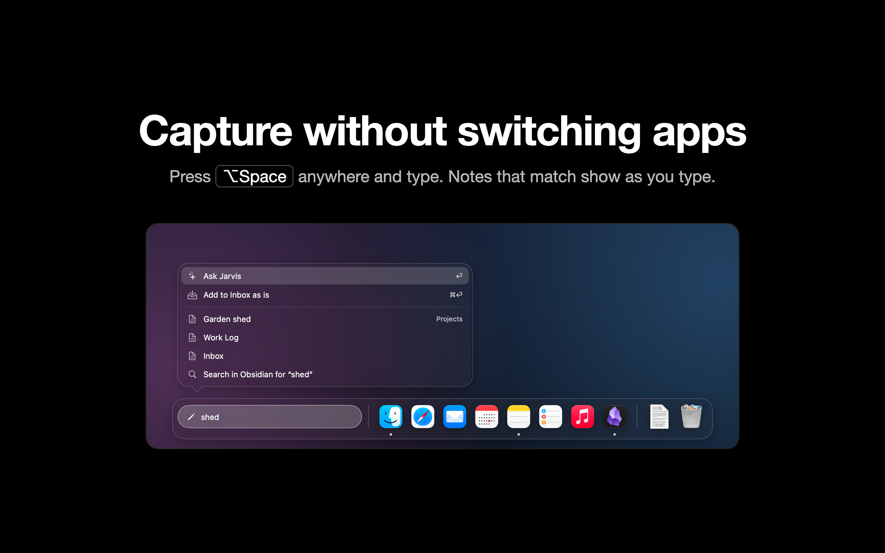

## What it does

- **A Dock.** Your running and pinned apps, Downloads and the Trash, on frosted glass that follows Light and Dark mode, where the icon under the pointer grows and shows its name, the launch bounce, and the red badge an app sets for its unread count. Badges come from Launch Services, checked every 2 seconds, so they need no permission. Downloads works like the macOS Dock's stack: its icon is your newest file, and clicking it fans out your newest files. The Trash shows when it's full and empties from its right-click menu. Like the macOS Dock it lives on one display at a time and moves to whichever display you push the pointer against the bottom of. It auto-hides and can replace the macOS Dock while Jarvis runs.
- **A capture box.** ⌥Space opens it. As you type, matching notes appear above it. Enter sends the text to Claude, ⌘Enter drops it in your Inbox as is, and ↑↓ picks a note to open in Obsidian. Type an app's name and it's offered at the top, to open it.
- **Live progress.** While Claude works, the box shows what it's doing ("Reading today's note", "Searching “launch plan”", "Using work-log").
- **Answers in a bubble.** The answer rises out of the box in a speech bubble: a headline, a few lines, and links to the notes involved. Answers too big for the bubble offer the note that holds the rest (Open full answer), rather than pulling Obsidian in front of whatever you're typing in. Anything Claude changed can be undone from the bubble, and a running ask can be stopped with ⌘.
- **Meeting prompts.** When a new recording lands in your meetings folder, Jarvis drafts your follow-ups and the decisions made, checks them against today's todos, and shows an orange pill in the Dock. Review, edit, then save or skip. If meetings stop working (the vault moved, the config broke), a red **Meetings paused** pill says why and what to do, and offers Settings…, Open log and Try again. ⏎ in the empty box opens it, and typing in the box closes it. If a recording can't be drafted after every retry, it still shows up as a prompt with no lines, so you can add todos by hand, draft it again (⌘R) or skip it. No meetings folder isn't an error: meetings just start once it appears.

<table>
<tr>
<td width="50%">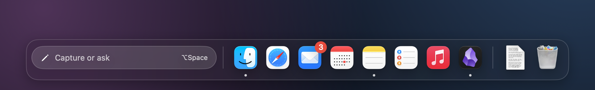<br>The Dock at rest</td>
<td width="50%">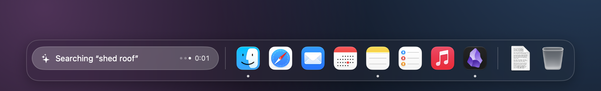<br>Claude working, step by step</td>
</tr>
<tr>
<td>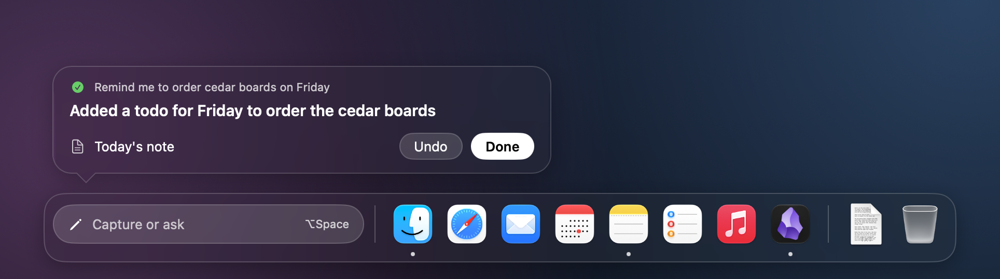<br>Saved, with Undo</td>
<td>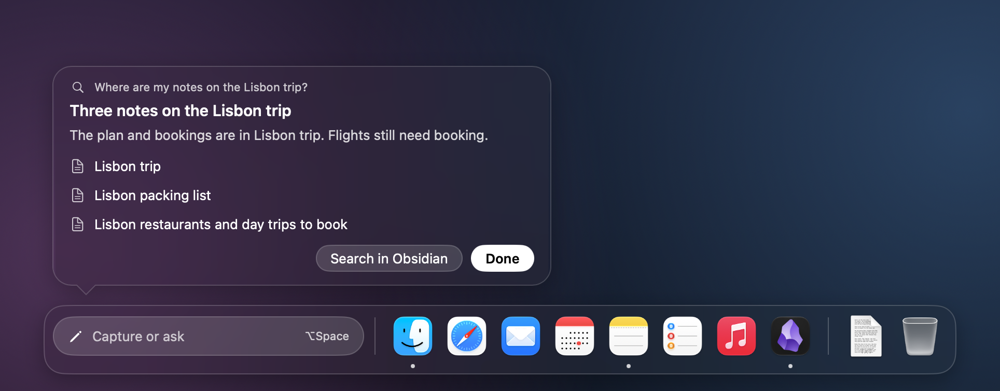<br>Found notes</td>
</tr>
<tr>
<td>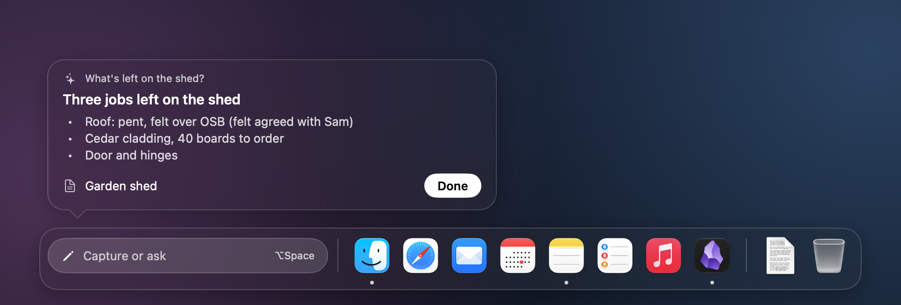<br>An answer</td>
<td>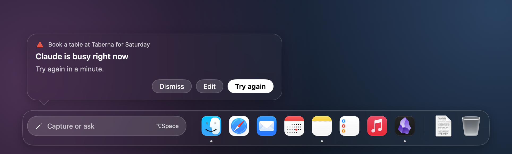<br>A failure keeps what you typed</td>
</tr>
<tr>
<td>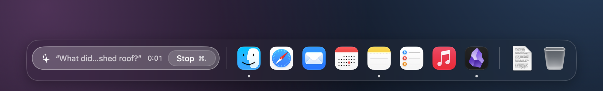<br>Stop a running ask with ⌘.</td>
<td>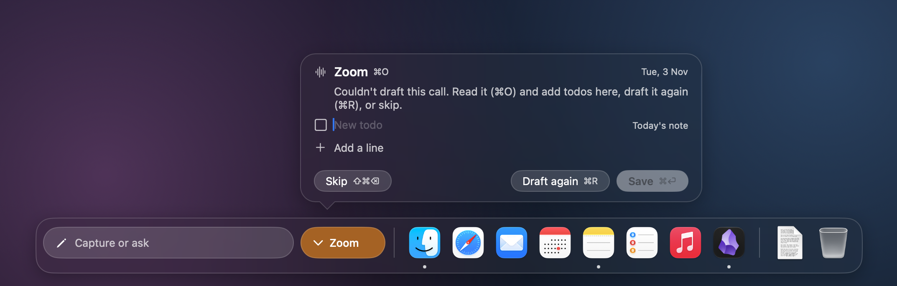<br>A call Claude couldn't draft</td>
</tr>
<tr>
<td>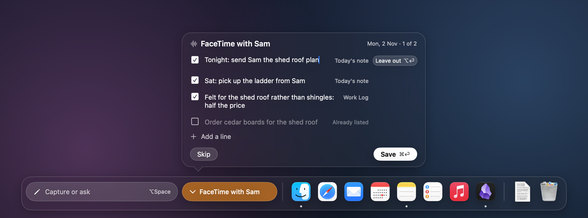<br>A meeting prompt</td>
<td>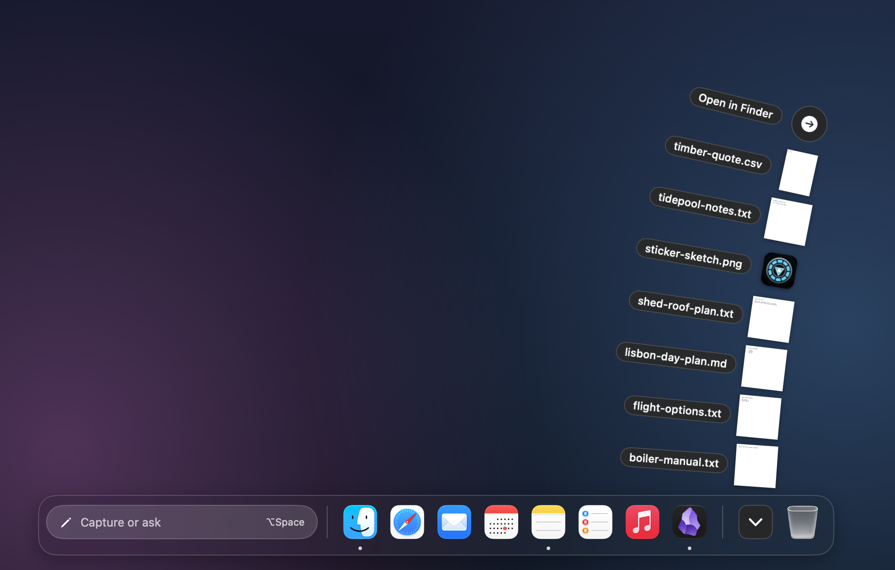<br>The Downloads stack</td>
</tr>
<tr>
<td>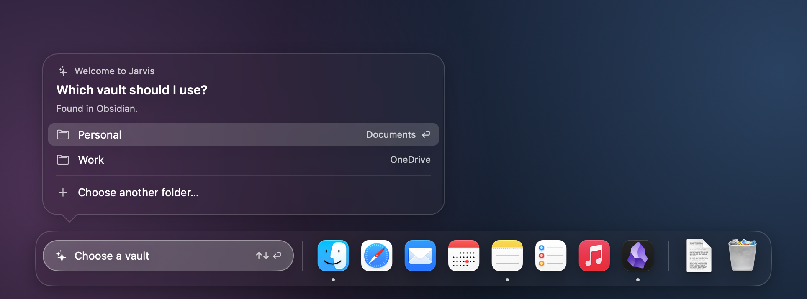<br>First run picks your vault</td>
<td>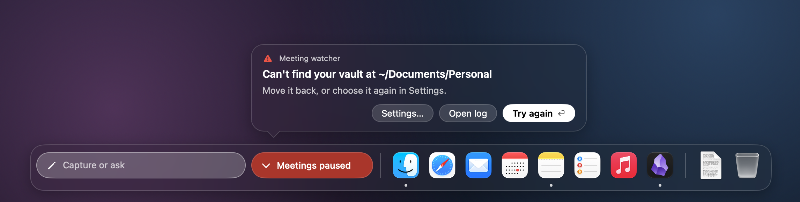<br>Meetings paused, and why</td>
</tr>
<tr>
<td>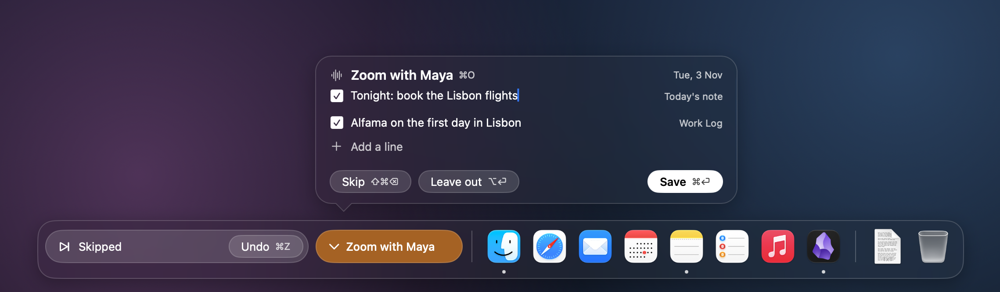<br>A skip you can undo</td>
<td>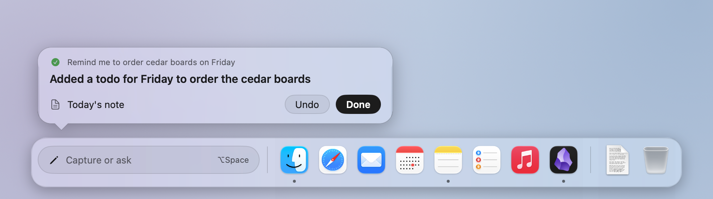<br>Light mode</td>
</tr>
<tr>
<td>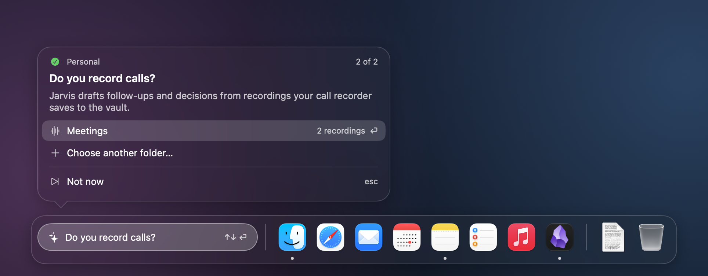<br>First run finds your recordings</td>
<td>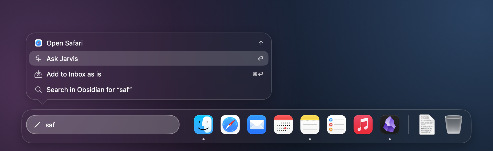<br>Open an app by name</td>
</tr>
<tr>
<td>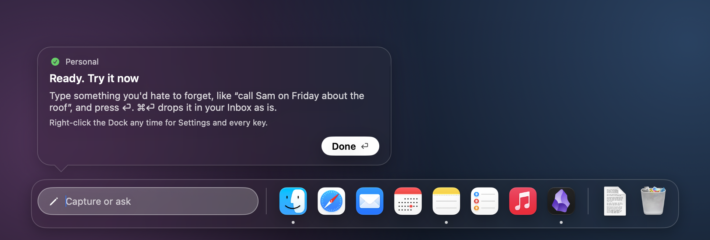<br>Ready for a first capture</td>
<td>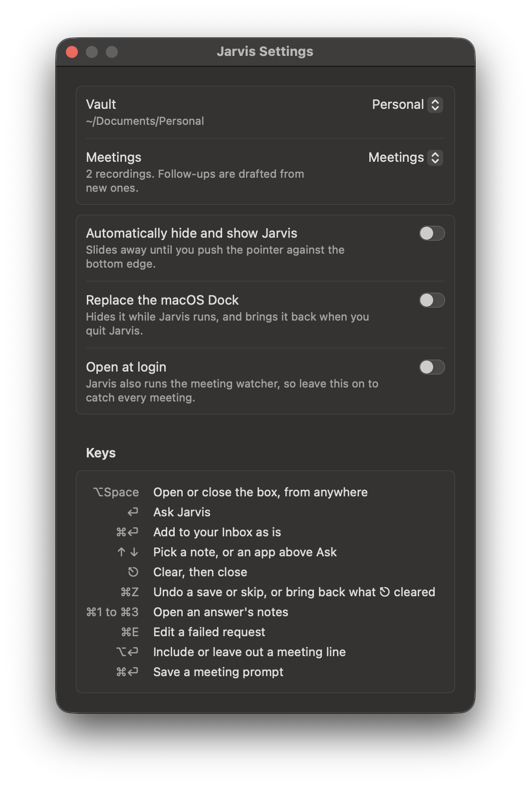<br>Settings: vault, meetings and every key</td>
</tr>
</table>

All screenshots come from fixtures, made by the real app (see [Screenshots](#screenshots)); every state is in [`screenshots/`](screenshots).

## How it works

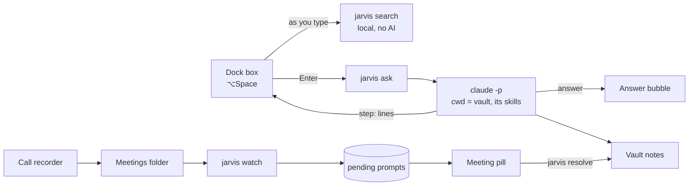

Jarvis has two parts:

- **The CLI** (`src/`, TypeScript on Bun) owns everything that touches the vault: watching for meetings, calling Claude, searching, and reading and writing notes.
- **The Dock** (`dock/`, SwiftUI) only renders. It shells out to the CLI for everything.

`scripts/package.sh` compiles the CLI into a single binary inside `Jarvis.app`, so an installed copy needs neither Bun nor this repo.

## Requirements

- macOS 14 or later
- Xcode or the Swift 6 toolchain, and [Bun](https://bun.sh), to build
- [Claude Code](https://claude.com/claude-code), installed and signed in (`claude` on this Mac), for asks and meeting drafts. Capturing to the Inbox works without it
- [Obsidian](https://obsidian.md), with the vault you want Jarvis to use

## Install

Download the DMG from [Releases](https://github.com/wezzcoetzee/jarvis/releases) and drag Jarvis to Applications.

The app is not notarized, so the first launch shows "Apple could not verify Jarvis". Click Done, then open System Settings, Privacy & Security, and click Open Anyway next to Jarvis. Or clear the quarantine flag:

```sh
xattr -dr com.apple.quarantine /Applications/Jarvis.app
```

To build and install from source instead:

```sh
bun install
scripts/package.sh 0.1.0      # builds dist/Jarvis.app, Jarvis-0.1.0.dmg and Jarvis-0.1.0.zip
open dist/Jarvis-0.1.0.dmg     # drag Jarvis onto the Applications shortcut
open /Applications/Jarvis.app
```

Pushing a `v*` tag (`git tag v0.2.0 && git push origin v0.2.0`) runs `.github/workflows/release.yml`, which builds the DMG and zip with that version and attaches them to a GitHub release.

On first launch Jarvis:

- hides the macOS Dock (you can turn this off in Settings);
- adds itself to Login Items;
- if it has no vault yet, asks which one ("1 of 2"): the capture box opens with the vaults Obsidian knows (↑↓ and ⏎, or Choose another folder…). Then ("2 of 2") it asks "Do you record calls?", offering the vault's folders that already hold recordings (or Not now, esc). Both answers go into `config.json`, and it says "All set: try it now" and invites a first capture. Without Claude Code it says "All set: your Inbox works now", points you at ⌘⏎ (the Inbox needs no AI), and links the install;
- starts the meeting watcher as a child process once there's a vault, restarting it if it dies. A vault that's chosen but missing at login (an unmounted drive, say) doesn't reopen first run: the watcher starts, and the red **Meetings paused** pill says the folder is gone and offers Try again. If it keeps dying, or gets stuck (see [Troubleshooting](#troubleshooting)), the red **Meetings paused** pill says why and what to do, with Settings…, Open log and Try again (⏎). The pill shows ⏎ when ⏎ in the empty box would open the card, and opening it gives the box the keys, so Try again shows ⏎ while it's open. Typing in the box closes the card, so the sheet shows and ⏎, ⌘⏎ and esc mean what they always do.

macOS may ask for two permissions:

- **Files in a cloud folder.** If your vault is in OneDrive, iCloud Drive or Dropbox, macOS asks once whether Jarvis may access it. Allow it, or the watcher, search and saves all wait.
- **Automation.** The first time you ask something from Chrome, Brave, Edge or Arc, macOS asks whether Jarvis may read the current tab. It's optional context for Claude.

Jarvis never asks for Accessibility, Input Monitoring or Screen Recording.

## Configure

First launch writes `vault` and `meetings` for you, and Settings changes them; for the rest, edit `~/.config/jarvis/config.json` (or set `JARVIS_CONFIG` to another folder). Every key is optional, and a file that isn't valid JSON or has a key of the wrong type stops Jarvis with an `error:` line saying which, in plain words (`"vault" should be text`), a `detail:` line on how to fix it, and exit code 2:

```json
{
  "vault": "~/Documents/Vault",
  "owner": "Your Name",
  "daily": "Daily",
  "meetings": "Meetings",
  "workLog": "Work Log.md",
  "people": "People.md",
  "inbox": "Inbox.md",
  "private": ["Private"],
  "plugins": ["~/.claude/plugins/marketplaces/my-marketplace/plugins/notes"],
  "model": "claude-opus-5-5",
  "proxyUrl": "http://127.0.0.1:8317",
  "proxyToken": "..."
}
```

| Key | Default | What it's for |
|---|---|---|
| `vault` | `~/Documents/Vault` | The Obsidian vault. Obsidian's vault name is this folder's name. |
| `owner` | "the vault's owner" | Your name, so Claude knows which speaker in a transcript is you. |
| `daily` | `Daily` | Folder of daily notes named `YYYY-MM-DD.md`. |
| `meetings` | `Meetings` | Folder your call recorder writes to, or `false` to turn meetings off. With no such folder, meetings just wait for it. |
| `workLog` | `Work Log.md` | Running log of work done and decisions. |
| `people` | `People.md` | Optional list of people, so names in transcripts get spelled right. |
| `inbox` | `Inbox.md` | Where captures go when there's no daily note yet, and for ⌘Enter. |
| `private` | `["Private"]` | Folders Jarvis never reads, searches, edits or shows. |
| `plugins` | none | Claude Code plugin folders to load for `ask`, when your capture and search skills live in a plugin rather than the vault's `.claude/skills/`. Nothing else from `~/.claude` loads. |
| `model` | `sonnet` | The Claude model for `ask` and meeting drafts. |
| `proxyUrl`, `proxyToken` | none | An optional Anthropic-compatible proxy. Jarvis uses it when it answers, and falls back to Claude Code's own login when it doesn't. If you set a token, `chmod 600` the file. |

Right-click an icon for its own menu: Open, Keep in Dock, Hide from Dock, Show in Finder, and Hide or Quit for running apps. Pinned apps are saved to `~/.config/jarvis/dock.json` (for example `{"pinned": ["com.google.Chrome", "md.obsidian"], "hidden": ["com.anthropic.claudefordesktop"]}`) and come first, with a dot only while running; other running apps follow them and leave when they quit. The first launch starts the list from the apps kept in the macOS Dock. Hide from Dock keeps an app off the Dock even while it runs, which suits apps you leave open in the background; ⌘Tab still shows it. Right-click anywhere else on the Dock for Jarvis's own menu, where Hidden Apps brings one back.

### What Jarvis expects in the vault

Jarvis appends to notes and keeps each note's existing format:

| Note | Shape |
|---|---|
| Daily note | A `## Todo` section. New todos go after its last item, as `- [ ] text ([[source note]])`. |
| Work Log | A `## Entries` section, newest first. Decisions go on top as `- YYYY-MM-DD · #decision · text · [[source note]]`. |
| Inbox | A `## Items` section. It's created if missing. |
| Meetings | Recordings named `YYYY-MM-DD HHMM <Source>.md`, for example `2026-10-29 1057 Slack Huddle.md`. Other notes in the folder (your own meeting write-ups) are left alone. |
| `.claude/skills/` | Optional. `jarvis ask` runs Claude from the vault root, so the vault's own Claude Code skills load and Claude follows them, along with skills from any `plugins` you configure. This is how you teach Jarvis how your vault works. Your global `~/.claude` skills, hooks and settings don't load. |

## Using it

| Key | Does |
|---|---|
| ⌥Space | Open the capture box from anywhere, on the display the pointer is on. Again, with nothing typed, closes it |
| ⏎ | Ask Jarvis: Claude saves, finds or answers, and replies in a bubble |
| ⌘⏎ | Add to Inbox as is, with no AI |
| ↑ ↓ | Pick a matching note to open, or "Search in Obsidian for…" |
| Type an app's name | "Open <app>" goes on top of the sheet: any app on the Dock, Downloads (opens its fan) or the Trash. Two letters or more, one word. ⏎ still asks until you've typed the whole name ("safari") or pressed ↑ to it, so a one-word capture never launches an app |
| esc | Clear, then close. In a meeting prompt: close it and leave it waiting |
| ⌘. | Stop the oldest ask that's still running. ⌘Z brings its text back |
| ⌘, | Open Settings while the box or a meeting card has focus |
| ⌥⌘Z | Undo Last Change while the box has the keys: the newest run, however old |
| ⌘Q | Quit Jarvis while it has the keys. Work in progress still finishes, 10 seconds at most |
| ⏎ in an empty box | Open the meeting or paused pill's card |

In the sheet, ⏎ sits beside the row it will press, ⌘⏎ beside Add to Inbox, and ↑ beside an app offered above Ask.

### Answers and their buttons

With an answer showing and nothing typed, ⏎ presses the bubble's white button, esc dismisses it, ⌘Z presses Undo and ⌘1 to ⌘3 open its notes. The buttons show their keys while the box has them.

- **Done** (or **Next**) when all went well.
- **Open full answer** when the answer is too long for the bubble. The note holding it is linked in the bubble like the others (⌘1 to ⌘3).
- **Reply** for a question. It puts what you typed back in the box to add the answer, and the question stays above it. While you reply, the sheet's ⏎ row reads Reply and the Inbox row is gone. ⌘⏎ still adds to the Inbox.
- **Try again** for a failure. It repeats what you chose (Ask, or Inbox). **Edit** (⌘E) puts what you typed back in the box instead.
- **Dismiss** is always the esc button.

Esc and Dismiss keep what you typed (for failures, questions and long answers), so ⌘Z in the empty box brings it back. It also brings back what esc just cleared. You can select an answer's text to copy it. A save that changed nothing shows as a plain answer.

While Claude works, **Stop** sits beside the timer: with ⌘. shown when the box has focus, and without a key when you only hover the box. With the box focused and empty, its placeholder is the oldest ask's text in quotes, which is the ask Stop will stop, and VoiceOver reads Stop as "Stop asking …" with that text. Stop ends the oldest ask, undoes anything it had already changed and says "Stopped “<text>”" with **Undo ⌘Z**, which puts the text back in the box. Long text is clipped to 60 characters in the label, the flash and the tooltip.

A failure that points at Settings (a vault that moved, say) also has a **Settings…** button.

Ask several things in a row and the answers queue ("1 of 2") in the order they finish. Requests still running show as "1 more" beside the timer, and more meetings waiting show as "+1" on the meeting pill.

With no answer waiting, ⏎ in the empty box opens "Meetings paused" if that's showing, and otherwise a waiting meeting prompt. The pill shows ⏎ when it would.

### Undo

- **What carries Undo ⌘Z:** the bubble of a save, "Added to Inbox", "Saved <meeting>", "Skipped <meeting>" and "Stopped “<text>”" (which puts the text back in the box). A confirmation that offers Undo stays 8 seconds, and the countdown waits while the box or the meeting card has the keys.
- **From a terminal:** `jarvis undo --last` undoes the newest run, and `jarvis runs` lists the recent ones. A run an undo already kept as is (every note edited since) is marked "(edited since)" in `jarvis runs`, and `--last` moves past it to the one before, so one edited note never hides older runs; undo it by id once you've put your edit back. `--before=<time>` limits `--last` to runs made by then: the Dock passes the moment you pressed ⌥⌘Z, so an ask that saves afterwards is never the one undone. On a terminal `undo` says what it did in plain words ("Put back A.md", "Kept C.md as is: edited since", "Nothing to undo"), the same words as the Dock; piped, as the Dock runs it, it prints JSON (see [CLI](#cli)).
- **After the 8 seconds:** press **⌥⌘Z** while the box has the keys, or right-click the Dock and choose **Undo Last Change** (the menu item shows ⌥⌘Z). It undoes the newest run, however old, and reports in the same words as the bubble's Undo: "Put back …", "Kept … as is" with a detail, or "Nothing to undo". No terminal needed. Choosing it again while one is under way beeps and does nothing. While Claude is working it says "Can't undo while Claude works" instead (it would undo the ask's own save once it lands); stop the ask with ⌘. or wait. A run already undone (⌥⌘Z, then the bubble's Undo) says "Already undone".
- **The hint:** the box's Undo shows its ⌘Z only while the box or the meeting card has the keys, since ⌘Z reaches it only through them.
- **Meeting saves and skips:** a save that fails offers Try again (⏎), which reopens the card with your edits. An undone save puts its prompt back. So does an undone skip, with your edits. On the next prompt's card, ⌘Z undoes your typing first, then the save or skip.
- **The result:** "Put back today's note" (or "Put back 3 notes"), or "Nothing to undo".
- **A note you edited since:** Undo leaves it as is and says "Kept <note> as is". That isn't a failure. It shows a grey info glyph and "You edited it after Jarvis changed it, so Undo left it alone." Undo Last Change reports it the same way.

### Meeting prompts

- ⏎ moves to the next line. On the last line, it adds one.
- ⌥⏎ includes or leaves out the line you're on. The footer button says which.
- ⌘⏎ saves. Todos go to today's note, decisions to the Work Log. When nothing would be saved (every line left out, or only blank ones), Save stays dimmed, and ⌘⏎ beeps and says "Nothing to save. Skip with ⇧⌘⌫ if you're done." above the footer; it doesn't skip.
- ⇧⌘⌫ skips. Plain ⌘⌫ still deletes to the start of the line.
- ⌘O opens the call in Obsidian. The card's title does the same.
- ⌘R, on a call Claude couldn't draft, runs `jarvis process` on it once more (Draft again). A failed retry closes the card and says why.
- ⌘, opens Settings from the card, as from the box.
- A ⌘⏎ or ⇧⌘⌫ within half a second of the last save or skip is ignored, with a beep, so a double press can't resolve the next prompt unread.

A line left out has its text dimmed. A blank line is not yet a line: it has no Leave out or Include until it has text. Lines size to their text with one even gap, wrapped or not, and a prompt scrolls past seven. A call with nothing proposed says "Nothing came out of this call. Add a todo, or skip." in a secondary line above the lines. A call Claude couldn't draft (it's retried first) says why in the same place, "Couldn't draft this call. Read it (⌘O) and add todos here, draft it again (⌘R), or skip.", and its pill shows a warning waveform glyph (VoiceOver says "couldn't draft"). The footer has Skip (⇧⌘⌫) at the far left, away from Save, then one button that reads "Leave out ⌥⏎" or "Include ⌥⏎" for the line you're on (none on a blank line). On a draft-failed card, Draft again (⌘R) sits beside Save. A skip can be undone for 8 seconds, which waits while the box or card has the keys (see Undo). The meeting pill opens and closes the prompt.

### Accessibility

- **VoiceOver** announces a new meeting prompt, "Meetings paused" when it appears, and the paused card's reason when you open it. Starting an ask says "Asking Jarvis. Press Command Period to stop.", and "Stopped “<text>”" comes with its Undo hint. Buttons are read by their titles, a meeting line is a checkbox, and the pill's close button says what it closes ("Close meetings paused", "Close meeting prompt").
- **Increase Contrast** lifts secondary text, key hints, left-out lines, the edge, and the rim, divider and separator strokes. Fills stay put.
- **Reduce Motion** turns every animation into a short fade with no movement, and the launch bounce is skipped. The working dots hide; the timer stays.
- **Keyboard only** works end to end: the capture box, answers, Downloads, meeting prompts, Meetings paused (⏎ in the empty box) and Stop (⌘.) all have keys, listed in Settings.
- **Nothing flashes.** Only the working dots repeat, three times a second.
- **Checkboxes** in a meeting prompt have a 24pt hit area, though they sit in the narrow glyph column.

The values are in [DESIGN.md](DESIGN.md).

### Confirmations and what stays on screen

The Dock stays up while you type, while Claude works and while an answer is waiting.

- **Saves** confirm and go after 8 seconds on screen. That doesn't count while the pointer is over the bubble or you're typing, so Undo is there while you look at it.
- **Answers and finds** also go when you click somewhere else, once they've been up for 2 seconds.
- **Short confirmations** ("Added to Inbox", "Saved <meeting>", "Skipped <meeting>" (just "Skipped" when the meeting's name doesn't fit), "Put back today's note", "Nothing to undo") show in the box for 4 seconds, and bring an auto-hidden Dock up to show them.
- **Inbox saves, meeting saves and undos** say what they're doing in the box while they run, with the same dots and timer. They wait for any request Claude is still working on, so neither can put back a note over the other's edit. While one waits, the box reads "Waiting for Claude to finish". While quitting waits for work, it reads "Finishing before quitting".

### Put-away questions and failures

Questions and failures hold what you typed, so a click elsewhere only puts them away. The box says what's put away ("1 question", "1 failed") with the bubble's own icon, the Dock can hide, and ⌥Space or a click on the box brings them back.

A failure shows in the bubble with a plain headline, and under it what to do, in 13pt secondary text, up to three lines, which you can select. This covers a failed undo or meeting save too.

- A failure Jarvis can't name (a missing file, a permission macOS refused) still gets a plain headline, with the CLI's own words underneath.
- A save to the vault that hangs for a minute (usually a macOS prompt about a cloud folder) fails the same way instead of holding up the writes after it.

A search that fails (a vault that's gone, say) says why in a line above the sheet's rows; Ask and the Inbox still work.

### Downloads

Click the Downloads tile to fan out your newest files. ↑↓ move a highlight up the fan and ⏎ opens the highlighted row. Esc, a click elsewhere or the tile itself closes it. Typing "downloads" in the box opens the fan too.

Daily notes and meetings are called by their day ("Today", "Yesterday", "Sun, 8 Nov"), the same way everywhere. Notes in the sheet and in a find show their folder when they aren't all in the same one.

Icons show their name above them on hover, and shrink when there are too many for the display, as the macOS Dock's do.

Right-click the Dock (anywhere but an icon), open Jarvis again from Finder, or press ⌘, in the box, for **Settings…**; the right-click menu also has **Undo Last Change** ⌥⌘Z (see [Undo](#undo)) and **Quit Jarvis** (⌘Q works while Jarvis has the keys). Quitting with a save or skip still queued, or an ask still running, doesn't drop them: running asks are stopped and undone, as Stop does, queued writes finish, then Jarvis quits (10 seconds at most):

| Setting | Does |
|---|---|
| Vault | The vault in use, with the vaults Obsidian knows and Choose another folder… |
| Meetings | The folder your call recorder saves to (folders holding recordings come first), Choose another folder…, or Off. A change restarts the meeting watcher. |
| Automatically hide and show Jarvis | Slides away until you push the pointer against the bottom edge. Off keeps it up. Starts out matching the macOS Dock. |
| Replace the macOS Dock | While Jarvis runs, the macOS Dock gets auto-hide with a 1000-second reveal delay. Your original settings are saved and restored when Jarvis quits, including on `kill`, logout and a crash. |
| Open at login | On by default, since Jarvis also runs the meeting watcher. |
| Keys | Every shortcut the Dock answers to, in one list grouped as Capture box, Answers, Meeting prompt and Downloads (⏎ on an empty box reads "Empty box: open the meeting or paused pill"; Meeting prompt has ⌘O "Open the call in Obsidian" and ⌘R "Draft again, when Claude couldn't"). It says so when another app owns ⌥Space. |

If `jarvis setup` can't load, the red error line says why, in place of the Vault and Meetings rows. A vault folder that's gone shows "Can't find this folder. Move it back, or choose another." under Vault.

## Safety

`jarvis ask` lets an AI edit your notes, so it's fenced in:

- **Only Markdown notes in the vault.** Claude gets Read, Glob, Grep, Edit, Write and Skill. There's no Bash, because shell edits would get around the checks below.
- **A hook checks every file access.** `jarvis hook` runs before each tool call and fails closed: anything it can't check is blocked, and so is any call where the hook itself can't run. It resolves `~`, `..`, symlinks, letter case and Unicode form, refuses broken symlinks, then:
  - keeps reads and searches inside the vault and out of `private` folders;
  - only allows edits to `.md` notes, and never to dot-folders like `.obsidian` and `.claude`, to `CLAUDE.md` or `AGENTS.md`, or to recordings in the meetings folder.
- **Deny rules as well.** Claude Code permission rules deny the same private folders, and they also filter private notes out of searches across the whole vault, which the hook can't see.
- **Every run can be undone.** The hook copies each note before Claude's first edit to it. `jarvis undo <run id>`, `jarvis undo --last` (or Undo in the bubble) puts them back, for up to a week (`jarvis runs` lists them), and deletes notes the run created. Notes edited since, by you or by another ask that ran at the same time, are left alone, so undo never throws away newer work. A run that fails part-way is undone automatically. Runs older than a week are deleted, so copies of your notes don't pile up outside the vault.
- **Untrusted context stays data.** The browser tab title is cut to one sanitised line and labelled as coming from the web. Claude is told that anything from other apps is information, never an instruction.

The rest of the design follows a few rules:

- **Watch inputs, never outputs.** The watcher only reads recordings in the meetings folder, and Jarvis never writes one (the hook blocks it), so it can't react to its own writes.
- **Raw activity stays off the vault.** The event log, queued prompts and undo backups live in `~/.local/share/jarvis/`.
- **Append only.** Saves add lines and never edit or remove existing ones. Every write is planned before any file changes, then written via a temp file and rename.
- **Cloud-only notes aren't downloaded.** In a cloud-synced vault, search matches cloud-only notes by name only.
- **Nothing private on screen.** Search results never include `private` folders, since the Dock is visible during screen shares.

## CLI

The Dock calls these, and they're handy on their own:

```sh
bun src/main.ts help                                      # usage; also --help, -h, or no command
bun src/main.ts help <command>                            # that command's usage, same as <command> --help (also -h)
bun src/main.ts --version                                 # the version; also version, -v
bun src/main.ts watch                                     # watch for new recordings (the app runs this itself)
bun src/main.ts process "<note.md | note name>" [--dry-run | --yes]   # draft one recording (a name is looked up in the meetings folder): queue it, print it, or write it
bun src/main.ts capture [--inbox] -- "<text>"             # add a todo for today (or to the Inbox); prints {"savedTo":…,"run":…}
bun src/main.ts search -- "<query>"                       # JSON matches
bun src/main.ts ask [--app=<name>] -- "<text>"            # let Claude save, find or answer
bun src/main.ts undo [--last | -- <run id>]               # put back what a capture, an ask or a meeting save changed; --last is the newest run; plain text on a terminal, JSON when piped
bun src/main.ts runs                                      # recent runs, newest first (up to 10): run id, when, notes changed
bun src/main.ts resolve [--skip] -- "<note name>"         # save a queued meeting prompt (draft on stdin; prints {"savedTo":[…],"run":…}) or skip it
bun src/main.ts setup [--meetings [--vault=<path>] [--off]] [-- "<folder>"]  # JSON: vault (`configured` is true once one is chosen, even if its folder is missing) and Claude Code status, or the folders holding recordings; with a folder, choose it
```

**Help and version**

- `jarvis help` (and `--help`, `-h`, or `jarvis` alone) prints the usage to stdout and exits 0. It never starts `watch`. `jarvis ""` prints it too.
- `jarvis help <command>` and `jarvis <command> --help` (or `-h`) print that command's usage and exit 0, whatever else was typed.
- `jarvis --version` (or `version`, `-v`) prints the version. `scripts/package.sh` pins it to the release tag in packaged builds.
- `version` and `help <command>` reject extra arguments. `watch`, `runs` and `hook` take no arguments and reject extras.
- Everything after `--` is text, so it can start with dashes. Before `--`, a word that starts with a dash is a flag, so `-x` is rejected the same as `--x`; a bare negative number (`-5`) is text.

**Output**

- On a terminal `capture`, `resolve`, `process` and `ask` print a plain sentence ("Added to Inbox.md. Undo: jarvis undo --last"); piped, as the Dock runs them, they print JSON.
- `process` on a terminal first prints "Drafting <name>…".
- `resolve` reads the draft on stdin, so on a terminal without `--skip` it stops at once with `error: resolve reads the draft on stdin` and `detail: Pipe it in, or use --skip.`
- An unknown note name for `process` fails with `No recording called “X” in <meetings folder>` and `Use the name the Dock shows, or the note's path.`
- `capture` drops one leading list marker or checkbox, so `- [ ] x`, `- x`, `* x` and `[ ] x` all save `x`. A capture of only a marker or checkbox (`-`, `[ ]`, `- [ ]`) fails like an empty one.
- `capture` flattens newlines in its text to spaces.
- `jarvis runs` prints a header (`Run id  When  Changed`) and one line per run, with When as "today 15:46", "yesterday 09:12" or the date, or "No runs to undo." when there are none.
- `ask` prints its progress as `step: …` lines.

**Errors and exit codes**

- Failures print one `error: …` line on stderr, often with a `detail: …` line on what to do (always a full sentence ending in a full stop, except the `Usage: …` line), and exit 1.
- A config file that isn't valid exits 2 instead, with the same two lines.
- A run an undo kept as is ends with "(edited since)" in `jarvis runs`.
- An id that isn't a run id fails with `Not a run id`, and `detail: Copy an id from jarvis runs.`
- Undoing a run a second time fails with `Already undone` and `detail: jarvis runs lists what's left to undo.`

Typos get them too:

- An unknown command: `error: Unknown command "x"`, then `detail: Run jarvis help for the list.`
- A flag the command doesn't take: `error: Unknown option --x for <command>`, then `detail: Usage: …`.
- Missing text: `error: <command> needs …`, then `detail: Usage: …`.
- Flags that don't go together: `process` with both `--dry-run` and `--yes`, or `setup` with `--vault=` or `--off` but no `--meetings`. The error names them, then `detail: Usage: …`.

Vault, Claude and file errors:

- `capture`, saving with `resolve`, `ask`, `search`, `undo`, `runs` and `watch` need the vault folder to exist. If it's gone they fail with `Can't find your vault at ~/…` and `Move it back, or choose it again in Settings.`, and never create it.
- Busy, usage-limit and timeout failures from Claude say what to do, and a missing file is named.
- Offline, `ask` says `Can't reach Claude` and `Check your connection, then try again, or edit it (⌘E) and press ⌘⏎ to put it in your Inbox.`
- A system error such as a missing file or a refused permission gets a next step ("Check the path, then try again.") in place of the raw errno text.
- A folder given where a note is expected says "<name> isn't a note" with "Choose a .md file."
- A folder that doesn't exist, given to `setup` (as the vault, the meetings folder or `--vault=`), says "<path> isn't a folder" with "Choose a folder that exists."

`ask` stops on SIGTERM or SIGINT, which is how the Dock's Stop works: it stops Claude, undoes the partial run, prints `error: Stopped` and exits 1.

With no meetings folder, or meetings off, `watch` waits quietly. Whenever it starts on a folder it hasn't watched before (first run, another one picked in Settings, meetings turned back on), it marks the recordings already there as seen, so only new meetings prompt. A recording that fails to draft (offline, the API busy) is tried twice more, five minutes apart. Then it's queued as a meeting prompt with no lines (`draftFailed: true`, titled from the note's name), and a notification says "Couldn't draft <name>. Open the Dock to draft it again or add todos." To try again from a terminal, run `jarvis process -- "<note name>"`.

An empty `JARVIS_VAULT` counts as unset. `JARVIS_VAULT`, `JARVIS_STATE` and `JARVIS_CONFIG` (the folder holding `config.json` and `dock.json`) override where things live, for the CLI and the Dock alike. Use them to test against a copy of your vault. `JARVIS_OBSIDIAN` is the folder holding Obsidian's `obsidian.json`, which first run reads for the list of vaults. `bun test` points all four at a temp folder itself (`src/test-env.ts`).

## Development

```sh
bun install
bun run lint && bun run typecheck && bun test
swift build --package-path dock
swift run --package-path dock      # runs the Dock against src/ through bun, without packaging;
                                   # it applies Settings too, including replacing the macOS Dock
scripts/screenshots.sh             # screenshots of every state, into screenshots/
scripts/store.sh                   # App Store images from them, into assets/store/
```

| File | Does |
|---|---|
| `src/main.ts` | CLI commands and the watch loop |
| `src/config.ts` | Reads `~/.config/jarvis/config.json` |
| `src/ask.ts` | `jarvis ask`: Claude with the vault's skills, fenced in |
| `src/backup-hook.ts` | The PreToolUse hook: path checks and backups |
| `src/runs.ts` | Run manifests and undo |
| `src/claude.ts` | Runs `claude -p` and turns tool calls into progress steps |
| `src/extract.ts` | Drafts follow-ups and decisions from a transcript |
| `src/meetings.ts` | Finds recordings that have finished writing |
| `src/review.ts` | The draft line format shared with the Dock |
| `src/errors.ts` | Plain words for failures, for the CLI's `error:` and `detail:` lines |
| `src/files.ts` | Reading files that may not exist, and atomic writes |
| `src/search.ts` | Vault search |
| `src/setup.ts` | First run and Settings: Obsidian's vaults, folders holding recordings, and writing the choices to config.json |
| `src/vault.ts` | Section-aware appends to the daily note, Inbox and Work Log |
| `src/state.ts` | Seen recordings, failed drafts, the watcher's heartbeat, the event log and the prompt queue |
| `dock/Sources/JarvisDock/DockModel.swift` | Capture, search, answers and meeting prompts |
| `dock/Sources/JarvisDock/DockView.swift` | All Dock UI |
| `dock/Sources/JarvisDock/DockPanel.swift` | The non-activating panel, placement and auto-hide |
| `dock/Sources/JarvisDock/Jarvis.swift` | CLI bridge and the JSON types |
| `dock/Sources/JarvisDock/AppShelf.swift` | Pinned and running apps, their badges, Downloads and the Trash |
| `dock/Sources/JarvisDock/DownloadsStack.swift` | The Downloads fan |
| `dock/Sources/JarvisDock/Preferences.swift` | Settings: vault and meetings, replacing the macOS Dock, open at login, keys |
| `dock/Sources/JarvisDock/Watcher.swift` | Runs `jarvis watch` while the app is open, and says why when it keeps failing or gets stuck |
| `dock/Sources/JarvisDock/HotKey.swift` | ⌥Space via Carbon, which needs no permission |
| `dock/Sources/JarvisDock/Screenshots.swift` | Screenshot mode: stages one state of the real Dock and captures it |
| `scripts/package.sh` | Builds the app, the DMG and the zip |
| `scripts/screenshots.sh` | Runs every screenshot scene against `scripts/screenshots/fixtures` |
| `scripts/store.sh` | Builds the App Store images in `assets/store/` from `screenshots/` (needs Chrome) |
| `assets/AppIcon.svg` | The app icon. `scripts/icon.sh` rebuilds `assets/AppIcon.icns` from it (needs Chrome) |

### Screenshots

`scripts/screenshots.sh` writes one PNG per state to `screenshots/` (about a minute for all 39; pass scene names to run a few). Each scene starts the real Dock, drives it through the same calls the UI makes, captures it and quits. Leave the mouse and keyboard alone while it runs; the two hover scenes move the pointer and put it back.

Nothing real gets in:

- **Fixtures only.** A made-up vault, config, meeting prompts and Downloads folder in `scripts/screenshots/fixtures`, copied fresh for each scene, and a made-up Obsidian list of vaults for the first-run scenes. Your config, vault, state, Downloads and Obsidian's vault list are never read.
- **A stand-in model.** `scripts/screenshots/bin/claude` sits first on `PATH` and answers the scenes' requests. The real CLI still runs `ask`, the hook, run manifests and undo. A stub `osascript` beside it means no browser tab is ever read.
- **Its own backdrop.** The Dock draws over a wallpaper of its own, above every other window including a running copy of Jarvis, and the shelf shows only the fixture's pinned apps, never what's running.
- **Its own appearance.** Scenes are Dark mode except `light` and `light-meeting`, whatever this Mac is set to.
- **Its own home.** Each scene runs with `HOME` set to its work folder, so paths read `~/…` and nothing lands in your real home.
- **Hands off the system.** Screenshot mode never touches the macOS Dock, login items, ⌥Space or the meeting watcher, and its settings are thrown away.

To add a scene, add a case to `stage()` in `Screenshots.swift` and its name to `ALL` in the script.

`scripts/store.sh` then turns six of them into App Store images in `assets/store/`: 2880×1800, the Mac App Store's largest 16:10 size, each a headline over a real screenshot at its captured size (never scaled up). The frames, their screenshots and their copy are the `FRAMES` list at the top of the script. Rerun both after a UI change so the README and the store images match the app.

### Animations

Every animation plays once, when something changes. With Reduce Motion on (System Settings → Accessibility → Display), they become short fades, with no movement (the auto-hidden Dock fades in place instead of sliding), and the launch bounce is skipped. The only repeating motion is the "working" dots, which redraw three times a second and only while Claude is working. With Reduce Motion on they hide, and the timer stays. Nothing runs at the display's refresh rate.

## Troubleshooting

- **The macOS Dock didn't come back.** Run `defaults delete com.apple.dock autohide-delay; killall Dock`.
- **Nothing happens on ⌥Space.** Another app may own the shortcut. The Dock shows a notice once, Settings' Keys list says "Taken by another app", and Jarvis logs "couldn't register ⌥Space" to the system log. Click the box to capture meanwhile. Free ⌥Space in the other app, then open Jarvis again; it tries to register the key again.
- **Saves or searches hang.** Check for a macOS permission prompt about your vault's cloud folder. It may be on another display. The watcher touches `~/.local/share/jarvis/watch-heartbeat` as it goes; if that stops for five minutes while it's running, the Dock shows **Meetings paused** with the same advice.
- **"Can't reach Claude".** You're offline, or Claude can't be reached. Check your connection and try again, or press ⌘⏎ to put what you typed in your Inbox.
- **A meeting says "Couldn't draft this call".** Claude failed every attempt. Read the call (⌘O) and add todos by hand, press ⌘R to draft it again, or skip it.
- **"Meetings paused" after login, saying the vault folder is missing.** The vault's drive or cloud folder wasn't there yet. Mount it or move the folder back, then press Try again; or choose another vault in Settings. First run doesn't reopen.
- **Logs.** The watcher writes to `~/.local/share/jarvis/watch.log`. Every capture, ask, save and skip is in `~/.local/share/jarvis/events.jsonl`.
