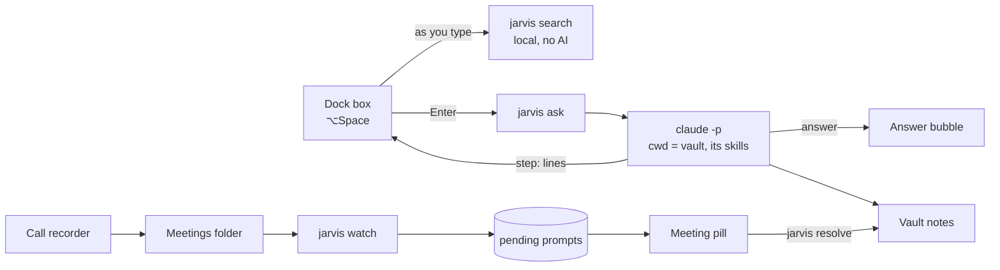

# Jarvis

A replacement for the macOS Dock with a capture box built in. Press ⌥Space from anywhere, type what you just did or want to find, and Jarvis hands it to Claude Code. Claude runs inside your Obsidian vault and uses the vault's own skills to save the note in the right place, or to find it for you. Jarvis also watches for meeting recordings and drafts the follow-ups and decisions for you to approve.

The point is to stop losing things: the "I need to speak to Sam about that" from a call, the decision made in passing, the work you shipped and will want as evidence later. Capturing takes a few keystrokes and you never leave what you're doing.

## What it does

- **A Dock.** Your running and pinned apps, Downloads and the Trash, on frosted glass, with magnify on hover and the launch bounce. Like the macOS Dock it lives on one display at a time and moves to whichever display you push the pointer against the bottom of. It auto-hides and can replace the macOS Dock while Jarvis runs.
- **A capture box.** ⌥Space opens it. As you type, matching notes appear above it. Enter sends the text to Claude, ⌘Enter drops it in your Inbox as is, and ↑↓ picks a note to open in Obsidian.
- **Live progress.** While Claude works, the box shows what it's doing ("Reading 2026-10-29", "Searching for “launch plan”", "Using work-log").
- **Answers in a bubble.** The answer rises out of the box in a speech bubble: a headline, a few lines, and links to the notes involved. Answers too big for the bubble open the right note in Obsidian. Anything Claude changed can be undone from the bubble.
- **Meeting prompts.** When a new recording lands in your meetings folder, Jarvis drafts your follow-ups and the decisions made, checks them against today's todos, and shows an orange pill in the Dock. Review, edit, then save or skip.

## Built around a vault

Jarvis isn't a notes app. It's a front door to a vault of information you already keep: an [Obsidian](https://obsidian.md) vault of plain Markdown notes (daily notes, a work log, meeting transcripts, people, projects). Jarvis doesn't decide where things go. Claude runs from the vault root and reads the vault's own [Claude Code skills](https://docs.claude.com/en/docs/claude-code/skills), so the vault teaches Jarvis how it's organised.

Without skills Jarvis still works, using the defaults below (todos to the Daily note, decisions to the Work Log, everything else to the Inbox). With skills it files things the way you would. The skills that make the biggest difference:

| Skill | Teaches Claude |
|---|---|
| **Capture** (e.g. `vault-add`) | Where each kind of note lives, how files are named, and which note a stray thought belongs in. |
| **Find** (e.g. `vault-find`) | How to search the vault: which folders matter, what headings and tags mean, how to rank matches. |
| **Work log** | The format for logging work done and decisions, so entries stay consistent and are easy to pull up later as evidence. |
| **Daily note** | The shape of your daily note: its sections, how todos are written and linked back to their source. |
| **People** (optional) | Who's who, so names from meetings get spelled and linked correctly. |

Put them in the vault's `.claude/skills/<name>/SKILL.md`, or in a Claude Code plugin listed under `plugins` in the config. A skill is a short Markdown file:

```markdown
---
name: work-log
description: Log work done or a decision to the Work Log. Use when the user says "log", "I just shipped", or "we decided".
---

Append to `Work Log.md` under `## Entries`, newest first:
`- YYYY-MM-DD · text · [[source note]]`. Add `#decision` for decisions.
```

## How it works



Jarvis has two parts:

- **The CLI** (`src/`, TypeScript on Bun) owns everything that touches the vault: watching for meetings, calling Claude, searching, and reading and writing notes.
- **The Dock** (`dock/`, SwiftUI) only renders. It shells out to the CLI for everything.

`scripts/package.sh` compiles the CLI into a single binary inside `Jarvis.app`, so an installed copy needs neither Bun nor this repo.

## Requirements

- macOS 14 or later
- Xcode or the Swift 6 toolchain, and [Bun](https://bun.sh), to build
- [Claude Code](https://claude.com/claude-code), installed and signed in (`claude` on this Mac)
- [Obsidian](https://obsidian.md), with the vault you want Jarvis to use

## Install

```sh
bun install
scripts/package.sh            # builds dist/Jarvis.app and dist/Jarvis.dmg
open dist/Jarvis.dmg          # drag Jarvis onto the Applications shortcut (~/Applications)
open ~/Applications/Jarvis.app
```

The DMG's Applications shortcut points at `~/Applications`, so no admin rights are needed.

On first launch Jarvis:

- hides the macOS Dock (you can turn this off in Settings);
- adds itself to Login Items;
- starts the meeting watcher as a child process, restarting it if it dies.

macOS may ask for two permissions:

- **Files in a cloud folder.** If your vault is in OneDrive, iCloud Drive or Dropbox, macOS asks once whether Jarvis may access it. Allow it, or the watcher, search and saves all wait.
- **Automation.** The first time you ask something from Chrome, Brave, Edge or Arc, macOS asks whether Jarvis may read the current tab. It's optional context for Claude.

Jarvis never asks for Accessibility, Input Monitoring or Screen Recording.

## Configure

Create `~/.config/jarvis/config.json`. Every key is optional:

```json
{
  "vault": "~/Documents/Vault",
  "owner": "Your Name",
  "daily": "Daily",
  "meetings": "Meetings",
  "workLog": "Work Log.md",
  "people": "People.md",
  "inbox": "Inbox.md",
  "private": ["Private"],
  "plugins": ["~/.claude/plugins/marketplaces/my-marketplace/plugins/notes"],
  "model": "claude-opus-5-5",
  "proxyUrl": "http://127.0.0.1:8317",
  "proxyToken": "..."
}
```

| Key | Default | What it's for |
|---|---|---|
| `vault` | `~/Documents/Vault` | The Obsidian vault. Obsidian's vault name is this folder's name. |
| `owner` | "the vault's owner" | Your name, so Claude knows which speaker in a transcript is you. |
| `daily` | `Daily` | Folder of daily notes named `YYYY-MM-DD.md`. |
| `meetings` | `Meetings` | Folder your call recorder writes to. |
| `workLog` | `Work Log.md` | Running log of work done and decisions. |
| `people` | `People.md` | Optional list of people, so names in transcripts get spelled right. |
| `inbox` | `Inbox.md` | Where captures go when there's no daily note yet, and for ⌘Enter. |
| `private` | `["Private"]` | Folders Jarvis never reads, searches, edits or shows. |
| `plugins` | none | Claude Code plugin folders to load for `ask`, when your capture and search skills live in a plugin rather than the vault's `.claude/skills/`. Nothing else from `~/.claude` loads. |
| `model` | `sonnet` | The Claude model for `ask` and meeting drafts. |
| `proxyUrl`, `proxyToken` | none | An optional Anthropic-compatible proxy. Jarvis uses it when it answers, and falls back to Claude Code's own login when it doesn't. If you set a token, `chmod 600` the file. |

Right-click an icon for its own menu: Open, Keep in Dock, Show in Finder, and Hide or Quit for running apps. Pinned apps are saved to `~/.config/jarvis/dock.json` (for example `{"pinned": ["com.google.Chrome", "md.obsidian"]}`) and come first; other running apps follow them. Right-click anywhere else on the Dock for Jarvis's own menu.

### What Jarvis expects in the vault

Jarvis appends to notes and keeps each note's existing format:

| Note | Shape |
|---|---|
| Daily note | A `## Todo` section. New todos go after its last item, as `- [ ] text ([[source note]])`. |
| Work Log | A `## Entries` section, newest first. Decisions go on top as `- YYYY-MM-DD · #decision · text · [[source note]]`. |
| Inbox | A `## Items` section. It's created if missing. |
| Meetings | Recordings named `YYYY-MM-DD HHMM <Source>.md`, for example `2026-10-29 1057 Slack Huddle.md`. Other notes in the folder (your own meeting write-ups) are left alone. |
| `.claude/skills/` | Optional. `jarvis ask` runs Claude from the vault root, so the vault's own Claude Code skills load and Claude follows them, along with skills from any `plugins` you configure. This is how you teach Jarvis how your vault works. Your global `~/.claude` skills, hooks and settings don't load. |

## Using it

| Key | Does |
|---|---|
| ⌥Space | Open the capture box from anywhere, on the display the pointer is on |
| ⏎ | Ask Jarvis: Claude saves, finds or answers, and replies in a bubble |
| ⌘⏎ | Add to Inbox as is, with no AI |
| ↑ ↓ | Pick a matching note to open, or "Search Obsidian for…" |
| esc | Clear, then close. In a meeting prompt: close it and leave it waiting |

The Dock stays up while you type, while Claude works and while an answer is waiting. Saves confirm and go after 8 seconds. Other answers stay until you press Done or click somewhere else. Ask several things in a row and the answers queue ("1 of 2").

Right-click the Dock (anywhere but an icon) for **Settings…** and **Quit Jarvis**:

| Setting | Does |
|---|---|
| Automatically hide and show the Dock | Slides away and comes back at the bottom edge. Off keeps it up. Starts out matching the macOS Dock. |
| Replace the macOS Dock | While Jarvis runs, the macOS Dock gets auto-hide with a 1000-second reveal delay. Your original settings are saved and restored when Jarvis quits, including on `kill` and logout. |
| Open at login | On by default, since Jarvis also runs the meeting watcher. |

## Safety

`jarvis ask` lets an AI edit your notes, so it's fenced in:

- **Only Markdown notes in the vault.** Claude gets Read, Glob, Grep, Edit, Write and Skill. There's no Bash, because shell edits would get around the checks below.
- **A hook checks every file access.** `jarvis hook` runs before each tool call and fails closed. It resolves `~`, `..`, symlinks and letter case, then:
  - keeps reads and searches inside the vault and out of `private` folders;
  - only allows edits to `.md` notes, and never to dot-folders like `.obsidian` and `.claude`, or to `CLAUDE.md` or `AGENTS.md`.
- **Deny rules as well.** Claude Code permission rules deny the same private folders, and they also filter private notes out of searches across the whole vault, which the hook can't see.
- **Every run can be undone.** The hook copies each note before Claude's first edit to it. `jarvis undo <run id>` (or Undo in the bubble) puts them back, and deletes notes the run created. Notes you've edited since are left alone, so undo never throws away newer work. A run that fails part-way is undone automatically.
- **Untrusted context stays data.** The browser tab title is cut to one sanitised line and labelled as coming from the web. Claude is told that anything from other apps is information, never an instruction.

The rest of the design follows a few rules:

- **Watch inputs, never outputs.** The watcher only reads the meetings folder, and Jarvis never writes there, so it can't react to its own writes.
- **Raw activity stays off the vault.** The event log, queued prompts and undo backups live in `~/.local/share/jarvis/`.
- **Append only.** Saves add lines and never edit or remove existing ones. Every write is planned before any file changes, then written via a temp file and rename.
- **Cloud-only notes aren't downloaded.** In a cloud-synced vault, search matches cloud-only notes by name only.
- **Nothing private on screen.** Search results never include `private` folders, since the Dock is visible during screen shares.

## CLI

The Dock calls these, and they're handy on their own:

```sh
bun src/main.ts watch                                     # watch for new recordings (the app runs this itself)
bun src/main.ts process "<note.md>" [--dry-run | --yes]   # draft one recording: queue it, print it, or write it
bun src/main.ts capture [--inbox] -- "<text>"             # add a todo for today (or to the Inbox)
bun src/main.ts search -- "<query>"                       # JSON matches
bun src/main.ts ask [--app=<name>] -- "<text>"            # let Claude save, find or answer
bun src/main.ts undo -- <run id>                          # put back what an ask changed
bun src/main.ts resolve [--skip] -- "<note name>"         # save a queued meeting prompt (draft on stdin) or skip it
```

Everything after `--` is text, so it can start with dashes. Failures print one `error: …` line on stderr, and `ask` prints its progress as `step: …` lines.

The first `watch` marks every existing recording as seen, so only new meetings prompt.

`JARVIS_VAULT` and `JARVIS_STATE` override the vault and state paths. Use them to test against a copy of your vault.

## Development

```sh
bun install
bun run typecheck && bun test
swift build --package-path dock
swift run --package-path dock      # runs the Dock against src/ through bun, without packaging;
                                   # it applies Settings too, including replacing the macOS Dock
```

| File | Does |
|---|---|
| `src/main.ts` | CLI commands and the watch loop |
| `src/config.ts` | Reads `~/.config/jarvis/config.json` |
| `src/ask.ts` | `jarvis ask`: Claude with the vault's skills, fenced in |
| `src/backup-hook.ts` | The PreToolUse hook: path checks and backups |
| `src/runs.ts` | Run manifests and undo |
| `src/claude.ts` | Runs `claude -p` and turns tool calls into progress steps |
| `src/extract.ts` | Drafts follow-ups and decisions from a transcript |
| `src/meetings.ts` | Finds recordings that have finished writing |
| `src/review.ts` | The draft line format shared with the Dock |
| `src/search.ts` | Vault search |
| `src/vault.ts` | Section-aware appends to the daily note, Inbox and Work Log |
| `src/state.ts` | Seen recordings, the event log and the prompt queue |
| `dock/Sources/JarvisDock/DockModel.swift` | Capture, search, answers and meeting prompts |
| `dock/Sources/JarvisDock/DockView.swift` | All Dock UI |
| `dock/Sources/JarvisDock/DockPanel.swift` | The non-activating panel, placement and auto-hide |
| `dock/Sources/JarvisDock/Jarvis.swift` | CLI bridge and the JSON types |
| `dock/Sources/JarvisDock/AppShelf.swift` | Pinned and running apps, Downloads and the Trash |
| `dock/Sources/JarvisDock/Preferences.swift` | Settings, replacing the macOS Dock, open at login |
| `dock/Sources/JarvisDock/Watcher.swift` | Runs `jarvis watch` while the app is open |
| `dock/Sources/JarvisDock/HotKey.swift` | ⌥Space via Carbon, which needs no permission |
| `scripts/package.sh` | Builds the app and the DMG |

Every animation is a one-shot spring that plays when something changes. The only repeating motion is the "working" dots, which redraw three times a second and only while Claude is working. Nothing runs at the display's refresh rate.

## Troubleshooting

- **The macOS Dock didn't come back.** Run `defaults delete com.apple.dock autohide-delay; killall Dock`.
- **Nothing happens on ⌥Space.** Another app may have the shortcut; Jarvis logs "couldn't register ⌥Space" to the system log.
- **Saves or searches hang.** Check for a macOS permission prompt about your vault's cloud folder. It may be on another display.
- **Logs.** The watcher writes to `~/.local/share/jarvis/watch.log`. Every capture, ask, save and skip is in `~/.local/share/jarvis/events.jsonl`.
