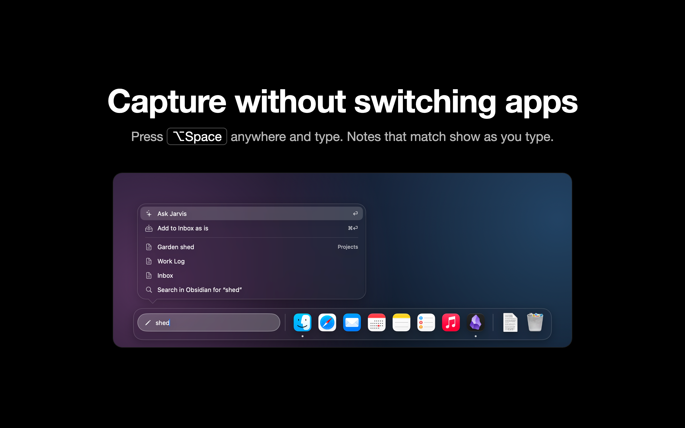
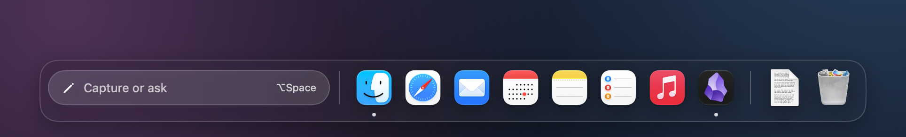
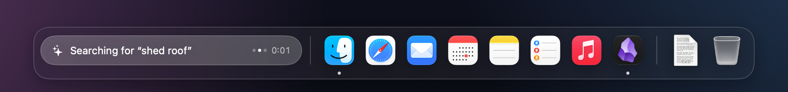
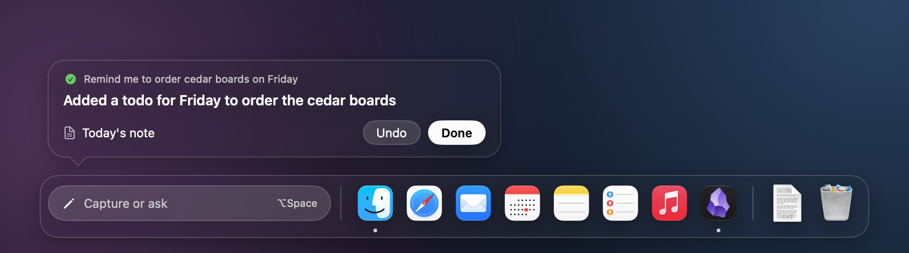
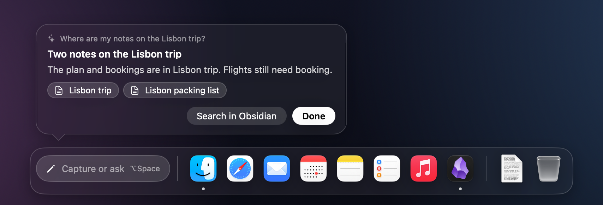
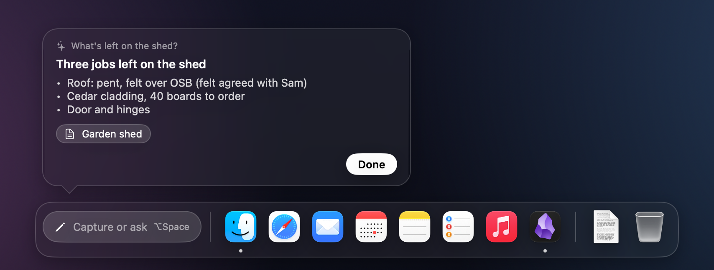
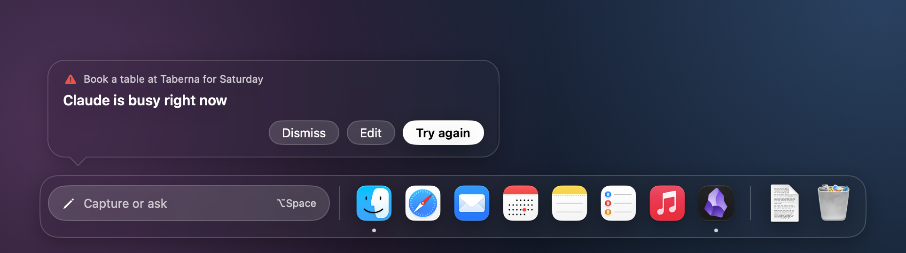
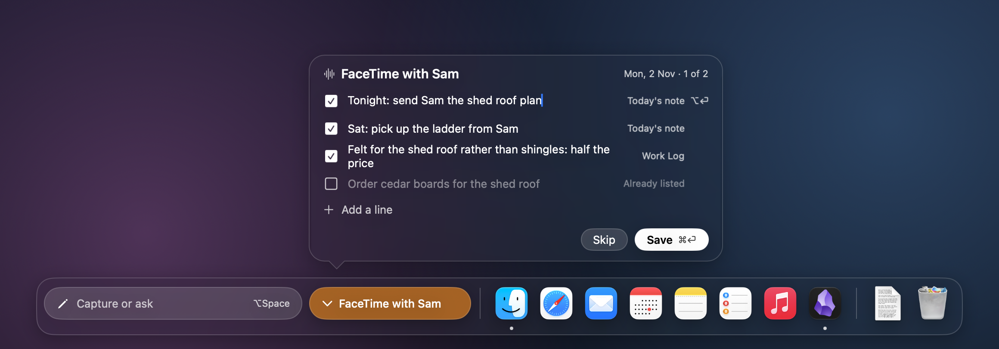
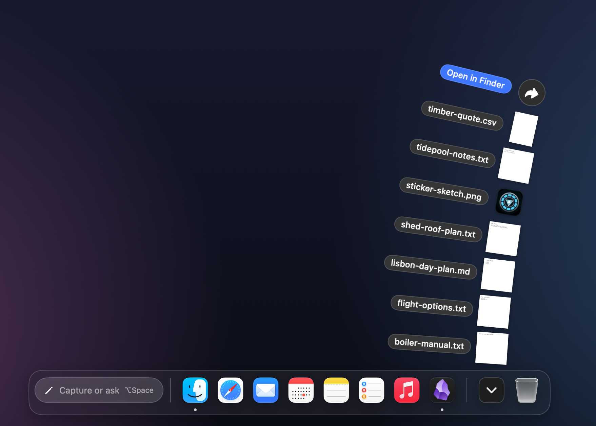
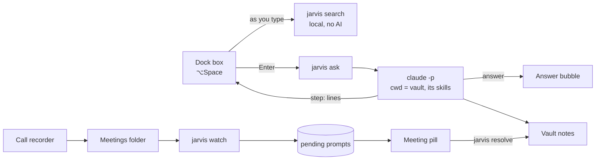

# Jarvis

A replacement for the macOS Dock with a capture box built in. Press ⌥Space from anywhere, type what you just did or want to find, and Jarvis hands it to Claude Code. Claude runs inside your Obsidian vault and uses the vault's own skills to save the note in the right place, or to find it for you. Jarvis also watches for meeting recordings and drafts the follow-ups and decisions for you to approve.

The point is to stop losing things: the "I need to speak to Sam about that" from a call, the decision made in passing, the work you shipped and will want as evidence later. Capturing takes a few keystrokes and you never leave what you're doing.



## What it does

- **A Dock.** Your running and pinned apps, Downloads and the Trash, on frosted glass, where the icon under the pointer grows and shows its name, the launch bounce, and the red badge an app sets for its unread count. Badges come from Launch Services, checked every 2 seconds, so they need no permission. Downloads works like the macOS Dock's stack: its icon is your newest file, and clicking it fans out your newest files. The Trash shows when it's full and empties from its right-click menu. Like the macOS Dock it lives on one display at a time and moves to whichever display you push the pointer against the bottom of. It auto-hides and can replace the macOS Dock while Jarvis runs.
- **A capture box.** ⌥Space opens it. As you type, matching notes appear above it. Enter sends the text to Claude, ⌘Enter drops it in your Inbox as is, and ↑↓ picks a note to open in Obsidian.
- **Live progress.** While Claude works, the box shows what it's doing ("Reading today's note", "Searching “launch plan”", "Using work-log").
- **Answers in a bubble.** The answer rises out of the box in a speech bubble: a headline, a few lines, and links to the notes involved. Answers too big for the bubble offer the note that holds the rest (Open full answer), rather than pulling Obsidian in front of whatever you're typing in. Anything Claude changed can be undone from the bubble.
- **Meeting prompts.** When a new recording lands in your meetings folder, Jarvis drafts your follow-ups and the decisions made, checks them against today's todos, and shows an orange pill in the Dock. Review, edit, then save or skip.

<table>
<tr>
<td width="50%"><br>The Dock at rest</td>
<td width="50%"><br>Claude working, step by step</td>
</tr>
<tr>
<td><br>Saved, with Undo</td>
<td><br>Found notes</td>
</tr>
<tr>
<td><br>An answer</td>
<td><br>A failure keeps what you typed</td>
</tr>
<tr>
<td><br>A meeting prompt</td>
<td><br>The Downloads stack</td>
</tr>
</table>

All screenshots come from fixtures, made by the real app (see [Screenshots](#screenshots)); every state is in [`screenshots/`](screenshots).

## How it works



Jarvis has two parts:

- **The CLI** (`src/`, TypeScript on Bun) owns everything that touches the vault: watching for meetings, calling Claude, searching, and reading and writing notes.
- **The Dock** (`dock/`, SwiftUI) only renders. It shells out to the CLI for everything.

`scripts/package.sh` compiles the CLI into a single binary inside `Jarvis.app`, so an installed copy needs neither Bun nor this repo.

## Requirements

- macOS 14 or later
- Xcode or the Swift 6 toolchain, and [Bun](https://bun.sh), to build
- [Claude Code](https://claude.com/claude-code), installed and signed in (`claude` on this Mac)
- [Obsidian](https://obsidian.md), with the vault you want Jarvis to use

## Install

Download the DMG from [Releases](https://github.com/wezzcoetzee/jarvis/releases) and drag Jarvis to Applications.

The app is not notarized, so the first launch shows "Apple could not verify Jarvis". Click Done, then open System Settings, Privacy & Security, and click Open Anyway next to Jarvis. Or clear the quarantine flag:

```sh
xattr -dr com.apple.quarantine ~/Applications/Jarvis.app
```

To build and install from source instead:

```sh
bun install
scripts/package.sh 0.1.0      # builds dist/Jarvis.app, Jarvis-0.1.0.dmg and Jarvis-0.1.0.zip
open dist/Jarvis-0.1.0.dmg     # drag Jarvis onto the Applications shortcut (~/Applications)
open ~/Applications/Jarvis.app
```

The DMG's Applications shortcut points at `~/Applications`, so no admin rights are needed.

Pushing a `v*` tag (`git tag v0.2.0 && git push origin v0.2.0`) runs `.github/workflows/release.yml`, which builds the DMG and zip with that version and attaches them to a GitHub release.

On first launch Jarvis:

- hides the macOS Dock (you can turn this off in Settings);
- adds itself to Login Items;
- starts the meeting watcher as a child process, restarting it if it dies.

macOS may ask for two permissions:

- **Files in a cloud folder.** If your vault is in OneDrive, iCloud Drive or Dropbox, macOS asks once whether Jarvis may access it. Allow it, or the watcher, search and saves all wait.
- **Automation.** The first time you ask something from Chrome, Brave, Edge or Arc, macOS asks whether Jarvis may read the current tab. It's optional context for Claude.

Jarvis never asks for Accessibility, Input Monitoring or Screen Recording.

## Configure

Create `~/.config/jarvis/config.json` (or set `JARVIS_CONFIG` to another folder). Every key is optional, and a file that isn't valid JSON or has a key of the wrong type stops Jarvis with one `error:` line saying which:

```json
{
  "vault": "~/Documents/Vault",
  "owner": "Your Name",
  "daily": "Daily",
  "meetings": "Meetings",
  "workLog": "Work Log.md",
  "people": "People.md",
  "inbox": "Inbox.md",
  "private": ["Private"],
  "plugins": ["~/.claude/plugins/marketplaces/my-marketplace/plugins/notes"],
  "model": "claude-opus-5-5",
  "proxyUrl": "http://127.0.0.1:8317",
  "proxyToken": "..."
}
```

| Key | Default | What it's for |
|---|---|---|
| `vault` | `~/Documents/Vault` | The Obsidian vault. Obsidian's vault name is this folder's name. |
| `owner` | "the vault's owner" | Your name, so Claude knows which speaker in a transcript is you. |
| `daily` | `Daily` | Folder of daily notes named `YYYY-MM-DD.md`. |
| `meetings` | `Meetings` | Folder your call recorder writes to. |
| `workLog` | `Work Log.md` | Running log of work done and decisions. |
| `people` | `People.md` | Optional list of people, so names in transcripts get spelled right. |
| `inbox` | `Inbox.md` | Where captures go when there's no daily note yet, and for ⌘Enter. |
| `private` | `["Private"]` | Folders Jarvis never reads, searches, edits or shows. |
| `plugins` | none | Claude Code plugin folders to load for `ask`, when your capture and search skills live in a plugin rather than the vault's `.claude/skills/`. Nothing else from `~/.claude` loads. |
| `model` | `sonnet` | The Claude model for `ask` and meeting drafts. |
| `proxyUrl`, `proxyToken` | none | An optional Anthropic-compatible proxy. Jarvis uses it when it answers, and falls back to Claude Code's own login when it doesn't. If you set a token, `chmod 600` the file. |

Right-click an icon for its own menu: Open, Keep in Dock, Hide from Dock, Show in Finder, and Hide or Quit for running apps. Pinned apps are saved to `~/.config/jarvis/dock.json` (for example `{"pinned": ["com.google.Chrome", "md.obsidian"], "hidden": ["com.anthropic.claudefordesktop"]}`) and come first, with a dot only while running; other running apps follow them and leave when they quit. The first launch starts the list from the apps kept in the macOS Dock. Hide from Dock keeps an app off the Dock even while it runs, which suits apps you leave open in the background; ⌘Tab still shows it. Right-click anywhere else on the Dock for Jarvis's own menu, where Hidden Apps brings one back.

### What Jarvis expects in the vault

Jarvis appends to notes and keeps each note's existing format:

| Note | Shape |
|---|---|
| Daily note | A `## Todo` section. New todos go after its last item, as `- [ ] text ([[source note]])`. |
| Work Log | A `## Entries` section, newest first. Decisions go on top as `- YYYY-MM-DD · #decision · text · [[source note]]`. |
| Inbox | A `## Items` section. It's created if missing. |
| Meetings | Recordings named `YYYY-MM-DD HHMM <Source>.md`, for example `2026-10-29 1057 Slack Huddle.md`. Other notes in the folder (your own meeting write-ups) are left alone. |
| `.claude/skills/` | Optional. `jarvis ask` runs Claude from the vault root, so the vault's own Claude Code skills load and Claude follows them, along with skills from any `plugins` you configure. This is how you teach Jarvis how your vault works. Your global `~/.claude` skills, hooks and settings don't load. |

## Using it

| Key | Does |
|---|---|
| ⌥Space | Open the capture box from anywhere, on the display the pointer is on. Again, with nothing typed, closes it |
| ⏎ | Ask Jarvis: Claude saves, finds or answers, and replies in a bubble |
| ⌘⏎ | Add to Inbox as is, with no AI |
| ↑ ↓ | Pick a matching note to open, or "Search in Obsidian for…" |
| ⎋ esc | Clear, then close. In a meeting prompt: close it and leave it waiting |

In the sheet, ⏎ sits beside the row it will press.

With an answer showing and nothing typed, ⏎ presses the bubble's white button and ⎋ dismisses it; ⌘Z presses Undo and ⌘1 to ⌘3 open its notes. The white button is Done (or Next) when all went well, Open full answer when the answer is too long for the bubble, Reply for a question, which puts what you typed back in the box to add the answer (the question stays above it), and Try again for a failure, which repeats what you chose (Ask, or Inbox). A failure's Edit (⌘E) puts what you typed back in the box instead. The ⎋ button is always Dismiss; ⎋ on a failure keeps what you typed, so ⌘Z in the empty box brings it back. You can select an answer's text to copy it. The buttons show their keys while the box has them. With no answer waiting, ⏎ in the empty box opens a waiting meeting prompt.

In a meeting prompt, ⏎ moves to the next line (on the last line, it adds one), ⌥⏎ includes or leaves out the line you're on (the hint sits on that line), and ⌘⏎ saves. Todos go to today's note, decisions to the Work Log. A line left out is dimmed. With every line left out, the only button is Skip, and it takes a click: skipping can't be undone. The meeting pill opens and closes the prompt.

The Dock stays up while you type, while Claude works and while an answer is waiting. A save that changed nothing shows as a plain answer. Saves confirm and go after 8 seconds on screen, not counting while the pointer is over the bubble or you're typing, so Undo is there while you look at it. Answers and finds also go when you click somewhere else (once they've been up for 2 seconds). Questions and failures hold what you typed, so a click elsewhere only puts them away: the box says what's put away ("1 question", "1 failed") with the bubble's own icon, the Dock can hide, and ⌥Space or a click on the box brings them back. Ask several things in a row and the answers queue ("1 of 2") in the order they finish; requests still running show as "1 more" beside the timer, and more meetings waiting as "+1" on the meeting pill. Short confirmations ("Added to Inbox", "Saved <meeting>", "Skipped <meeting>", "Undone", "Nothing to undo") show in the box for 4 seconds, and bring an auto-hidden Dock up to show them. Failures, including a failed undo or meeting save, show in the bubble with a plain headline, and under it what to do or, for a failure it can't name, the CLI's own words. A save to the vault that hangs for a minute (usually a macOS prompt about a cloud folder) fails the same way instead of holding up the writes after it. An undo that kept a note as is because you edited it since isn't a failure, and isn't shown in red. ⌘Z in the empty box also brings back what ⎋ just cleared. Inbox saves, meeting saves and undos say what they're doing in the box while they run, with the same dots and timer.

Daily notes and meetings are called by their day ("Today", "Yesterday", "Sun, 8 Nov"), the same way everywhere. Notes in the sheet and in a find show their folder when they aren't all in the same one.

Icons show their name above them on hover, and shrink when there are too many for the display, as the macOS Dock's do.

Right-click the Dock (anywhere but an icon), or open Jarvis again from Finder, for **Settings…**; the right-click menu also has **Quit Jarvis**:

| Setting | Does |
|---|---|
| Automatically hide and show Jarvis | Slides away until you push the pointer against the bottom edge. Off keeps it up. Starts out matching the macOS Dock. |
| Replace the macOS Dock | While Jarvis runs, the macOS Dock gets auto-hide with a 1000-second reveal delay. Your original settings are saved and restored when Jarvis quits, including on `kill`, logout and a crash. |
| Open at login | On by default, since Jarvis also runs the meeting watcher. |

## Safety

`jarvis ask` lets an AI edit your notes, so it's fenced in:

- **Only Markdown notes in the vault.** Claude gets Read, Glob, Grep, Edit, Write and Skill. There's no Bash, because shell edits would get around the checks below.
- **A hook checks every file access.** `jarvis hook` runs before each tool call and fails closed: anything it can't check is blocked, and so is any call where the hook itself can't run. It resolves `~`, `..`, symlinks, letter case and Unicode form, refuses broken symlinks, then:
  - keeps reads and searches inside the vault and out of `private` folders;
  - only allows edits to `.md` notes, and never to dot-folders like `.obsidian` and `.claude`, to `CLAUDE.md` or `AGENTS.md`, or to recordings in the meetings folder.
- **Deny rules as well.** Claude Code permission rules deny the same private folders, and they also filter private notes out of searches across the whole vault, which the hook can't see.
- **Every run can be undone.** The hook copies each note before Claude's first edit to it. `jarvis undo <run id>` (or Undo in the bubble) puts them back, for up to a week, and deletes notes the run created. Notes edited since, by you or by another ask that ran at the same time, are left alone, so undo never throws away newer work. A run that fails part-way is undone automatically. Runs older than a week are deleted, so copies of your notes don't pile up outside the vault.
- **Untrusted context stays data.** The browser tab title is cut to one sanitised line and labelled as coming from the web. Claude is told that anything from other apps is information, never an instruction.

The rest of the design follows a few rules:

- **Watch inputs, never outputs.** The watcher only reads recordings in the meetings folder, and Jarvis never writes one (the hook blocks it), so it can't react to its own writes.
- **Raw activity stays off the vault.** The event log, queued prompts and undo backups live in `~/.local/share/jarvis/`.
- **Append only.** Saves add lines and never edit or remove existing ones. Every write is planned before any file changes, then written via a temp file and rename.
- **Cloud-only notes aren't downloaded.** In a cloud-synced vault, search matches cloud-only notes by name only.
- **Nothing private on screen.** Search results never include `private` folders, since the Dock is visible during screen shares.

## CLI

The Dock calls these, and they're handy on their own:

```sh
bun src/main.ts watch                                     # watch for new recordings (the app runs this itself)
bun src/main.ts process "<note.md>" [--dry-run | --yes]   # draft one recording: queue it, print it, or write it
bun src/main.ts capture [--inbox] -- "<text>"             # add a todo for today (or to the Inbox)
bun src/main.ts search -- "<query>"                       # JSON matches
bun src/main.ts ask [--app=<name>] -- "<text>"            # let Claude save, find or answer
bun src/main.ts undo -- <run id>                          # put back what an ask changed
bun src/main.ts resolve [--skip] -- "<note name>"         # save a queued meeting prompt (draft on stdin) or skip it
```

Everything after `--` is text, so it can start with dashes. Failures print one `error: …` line on stderr, and `ask` prints its progress as `step: …` lines.

The first `watch` marks every existing recording as seen, so only new meetings prompt. A recording that fails to draft (offline, the API busy) is tried twice more, five minutes apart, and only then given up on with a notification. Run `jarvis process` on it to try again by hand.

`JARVIS_VAULT`, `JARVIS_STATE` and `JARVIS_CONFIG` (the folder holding `config.json` and `dock.json`) override where things live, for the CLI and the Dock alike. Use them to test against a copy of your vault. `bun test` points all three at a temp folder itself (`src/test-env.ts`).

## Development

```sh
bun install
bun run lint && bun run typecheck && bun test
swift build --package-path dock
swift run --package-path dock      # runs the Dock against src/ through bun, without packaging;
                                   # it applies Settings too, including replacing the macOS Dock
scripts/screenshots.sh             # screenshots of every state, into screenshots/
scripts/store.sh                   # App Store images from them, into assets/store/
```

| File | Does |
|---|---|
| `src/main.ts` | CLI commands and the watch loop |
| `src/config.ts` | Reads `~/.config/jarvis/config.json` |
| `src/ask.ts` | `jarvis ask`: Claude with the vault's skills, fenced in |
| `src/backup-hook.ts` | The PreToolUse hook: path checks and backups |
| `src/runs.ts` | Run manifests and undo |
| `src/claude.ts` | Runs `claude -p` and turns tool calls into progress steps |
| `src/extract.ts` | Drafts follow-ups and decisions from a transcript |
| `src/meetings.ts` | Finds recordings that have finished writing |
| `src/review.ts` | The draft line format shared with the Dock |
| `src/files.ts` | Reading files that may not exist, and atomic writes |
| `src/search.ts` | Vault search |
| `src/vault.ts` | Section-aware appends to the daily note, Inbox and Work Log |
| `src/state.ts` | Seen recordings, failed drafts, the event log and the prompt queue |
| `dock/Sources/JarvisDock/DockModel.swift` | Capture, search, answers and meeting prompts |
| `dock/Sources/JarvisDock/DockView.swift` | All Dock UI |
| `dock/Sources/JarvisDock/DockPanel.swift` | The non-activating panel, placement and auto-hide |
| `dock/Sources/JarvisDock/Jarvis.swift` | CLI bridge and the JSON types |
| `dock/Sources/JarvisDock/AppShelf.swift` | Pinned and running apps, their badges, Downloads and the Trash |
| `dock/Sources/JarvisDock/DownloadsStack.swift` | The Downloads fan |
| `dock/Sources/JarvisDock/Preferences.swift` | Settings, replacing the macOS Dock, open at login |
| `dock/Sources/JarvisDock/Watcher.swift` | Runs `jarvis watch` while the app is open |
| `dock/Sources/JarvisDock/HotKey.swift` | ⌥Space via Carbon, which needs no permission |
| `dock/Sources/JarvisDock/Screenshots.swift` | Screenshot mode: stages one state of the real Dock and captures it |
| `scripts/package.sh` | Builds the app, the DMG and the zip |
| `scripts/screenshots.sh` | Runs every screenshot scene against `scripts/screenshots/fixtures` |
| `scripts/store.sh` | Builds the App Store images in `assets/store/` from `screenshots/` (needs Chrome) |
| `assets/AppIcon.svg` | The app icon. `scripts/icon.sh` rebuilds `assets/AppIcon.icns` from it (needs Chrome) |

### Screenshots

`scripts/screenshots.sh` writes one PNG per state to `screenshots/` (about a minute for all 27; pass scene names to run a few). Each scene starts the real Dock, drives it through the same calls the UI makes, captures it and quits. Leave the mouse and keyboard alone while it runs; the two hover scenes move the pointer and put it back.

Nothing real gets in:

- **Fixtures only.** A made-up vault, config, meeting prompts and Downloads folder in `scripts/screenshots/fixtures`, copied fresh for each scene. Your config, vault, state and Downloads are never read.
- **A stand-in model.** `scripts/screenshots/bin/claude` sits first on `PATH` and answers the scenes' requests. The real CLI still runs `ask`, the hook, run manifests and undo. A stub `osascript` beside it means no browser tab is ever read.
- **Its own backdrop.** The Dock draws over a wallpaper of its own, above every other window including a running copy of Jarvis, and the shelf shows only the fixture's pinned apps, never what's running.
- **Hands off the system.** Screenshot mode never touches the macOS Dock, login items, ⌥Space or the meeting watcher, and its settings are thrown away.

To add a scene, add a case to `stage()` in `Screenshots.swift` and its name to `ALL` in the script.

`scripts/store.sh` then turns six of them into App Store images in `assets/store/`: 2880×1800, the Mac App Store's largest 16:10 size, each a headline over a real screenshot at its captured size (never scaled up). The frames, their screenshots and their copy are the `FRAMES` list at the top of the script. Rerun both after a UI change so the README and the store images match the app.

### Animations

Every animation plays once, when something changes. With Reduce Motion on (System Settings → Accessibility → Display), they become short fades, with no movement (the auto-hidden Dock fades in place instead of sliding), and the launch bounce is skipped. The only repeating motion is the "working" dots, which redraw three times a second and only while Claude is working. Nothing runs at the display's refresh rate.

## Troubleshooting

- **The macOS Dock didn't come back.** Run `defaults delete com.apple.dock autohide-delay; killall Dock`.
- **Nothing happens on ⌥Space.** Another app may have the shortcut; Jarvis logs "couldn't register ⌥Space" to the system log.
- **Saves or searches hang.** Check for a macOS permission prompt about your vault's cloud folder. It may be on another display.
- **Logs.** The watcher writes to `~/.local/share/jarvis/watch.log`. Every capture, ask, save and skip is in `~/.local/share/jarvis/events.jsonl`.
